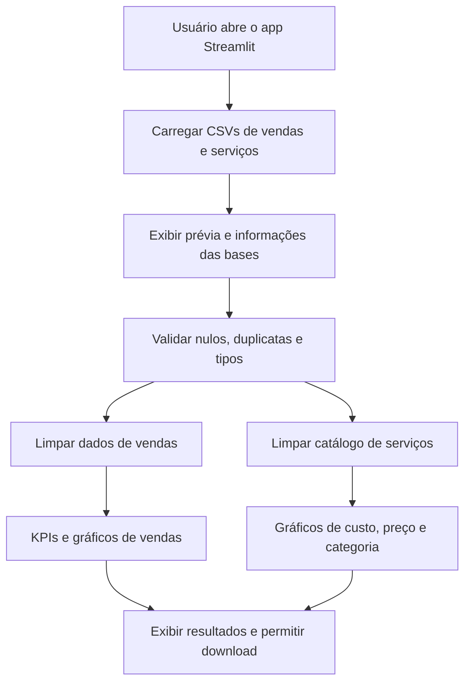

# 📊 Análise de vendas e catálogo de serviços

> Projeto de análise exploratória e preparação de dados de transações e serviços de um salão. O notebook carrega os dados, verifica sua qualidade, aplica limpeza e apresenta gráficos para apoiar a análise do negócio.

---

## 📋 Sobre o Projeto

O projeto inclui o notebook [`PIPELINE.ipynb`](PIPELINE.ipynb) e um app Streamlit (`app.py`), desenvolvidos em Python. Eles usam dados CSV publicados no GitHub para analisar dois conjuntos:

- **Transações de vendas**: recibos, data, cliente, funcionário, serviço/produto, quantidade, valor e impostos.
- **Catálogo de serviços**: descrição, categoria, custo, preço e situação ativa.

O notebook investiga valores ausentes, duplicatas e valores monetários atípicos, prepara versões limpas dos dados e explora relações entre preço, custo, categoria e situação dos serviços. Também exporta a base de vendas tratada para `vendas_limpo.csv`.

O app permite carregar os CSVs publicados ou enviar arquivos próprios, inspecionar e limpar os dados, visualizar gráficos e baixar os resultados tratados.

---

## 🏗️ Pipeline da Análise



### Etapas e funções

| Etapa | O que acontece | Operações representadas no notebook |
|---|---|---|
| **1. Carregamento** | Lê os CSVs de vendas e de serviços e cria os DataFrames. | `pd.read_csv()` |
| **2. Inspeção** | Mostra amostras, tipos de coluna, contagens de nulos e duplicatas. | `head()`, `info()`, `isnull()`, `duplicated()` |
| **3. Limpeza de vendas** | Remove linhas totalmente duplicadas e corrige o sinal de `Amount` para itens que não sejam `miscellaneous`. Mantém valores zero e a regra observada para `miscellaneous`. | `drop_duplicates()`, `np.where()`, `abs()` |
| **4. Limpeza do catálogo** | Remove registros sem descrição e registros com `Cost` igual a zero. A análise observa preços negativos e zeros antes de definir os filtros. | `dropna()`, filtro de `Cost` |
| **5. Análise de vendas** | Explora valores por funcionário e descrição e permite investigar valores negativos e recibos repetidos. | Gráficos com `seaborn` e filtros do pandas |
| **6. Análise de serviços** | Compara custo e preço, distribuição de preços e quantidade por categoria, separando serviços ativos e inativos. | `scatterplot()`, `boxplot()`, `countplot()` |
| **7. Saída** | Exporta os dados de vendas limpos e apresenta tabelas e gráficos. | `to_csv()` e gráficos Matplotlib/Seaborn |

### Organização no Streamlit

Na interface, há seleção de arquivo CSV ou carregamento das URLs padrão, opções de limpeza, abas para vendas e serviços, visualizações e botões de download. Os resultados são recalculados a partir das opções selecionadas pelo usuário.

---

## 🧹 Regras de Tratamento Observadas

| Conjunto | Regra atual no notebook |
|---|---|
| Vendas | Linhas integralmente duplicadas são removidas, mantendo a primeira ocorrência. |
| Vendas | Recibos repetidos são identificados, mas não removidos: podem pertencer a clientes diferentes. |
| Vendas | Datas repetidas não são tratadas como duplicatas, pois várias transações podem ocorrer no mesmo dia. |
| Vendas | `Amount` negativo é convertido em positivo, exceto quando `Description` é `miscellaneous`, cujo valor negativo é preservado. |
| Vendas | Valores zero e a ocorrência de `Quantity` negativa são inspecionados, sem remoção automática. |
| Serviços | A linha sem `Desc` é removida. |
| Serviços | Linhas com `Cost` igual a zero são removidas; `Price` igual a zero é permitido. |
| Serviços | O notebook não encontra preços negativos no catálogo após remover a linha sem descrição. |

Essas escolhas refletem as hipóteses registradas no notebook. Em particular, o sinal negativo de `miscellaneous` e o significado de quantidades negativas devem ser confirmados com quem conhece a origem dos dados antes de serem usados em relatórios oficiais.

---

## 📈 Visualizações Produzidas

- Dispersão de valor (`Amount`) por funcionário (`Staff`) para observar distribuição e valores atípicos.
- Dispersão entre custo (`Cost`) e preço (`Price`), segmentada por categoria e situação ativa.
- Boxplot de preços por categoria e situação ativa.
- Contagem de itens por categoria, separando ativos e inativos.

As observações anotadas no notebook apontam `STYLE` como categoria com preços mais altos e destacam um preço de 300 como outlier; `COLOR` aparece com maior quantidade de itens no catálogo analisado.

---

## 🛠️ Tecnologias


---

## 🚀 Como Executar

### Pré-requisitos

- Python 3.9 ou superior
- Streamlit
- Acesso à internet para baixar os CSVs das URLs configuradas no notebook

### Instalação e execução

```bash
git clone <url-do-repositorio>
cd ProjetoACE_4P
python -m venv .venv
source .venv/bin/activate  # Linux/macOS
# No Windows: .venv\Scripts\activate
pip install -r requirements.txt
streamlit run app.py
```

O Streamlit abrirá o painel no navegador. Por padrão, o app carrega os CSVs das URLs do projeto. Pela barra lateral, também é possível escolher **Enviar meus arquivos** e fornecer os dois CSVs. Os botões na página baixam as bases tratadas. Para abrir o notebook original, execute `jupyter notebook PIPELINE.ipynb` (instale `jupyter` separadamente, se necessário).

### Fontes de dados

O notebook busca os arquivos diretamente destas URLs:

- [Receipt Transactions0.csv](https://raw.githubusercontent.com/alvarolucio2007/Engenharia-de-Software/refs/heads/main/4Periodo/CienciaDeDados/ACE/Receipt%20Transactions0.csv)
- [Service Listing0.csv](https://raw.githubusercontent.com/alvarolucio2007/Engenharia-de-Software/refs/heads/main/4Periodo/CienciaDeDados/ACE/Service%20Listing0.csv)

No código, o arquivo de recibos é carregado em `df_vendas` e o arquivo de serviços em `df_transacoes`. O segundo DataFrame é tratado e renomeado para `df_transacao_limpo` durante a análise.

---

## ⚠️ Escopo Atual

O projeto contém o notebook de análise exploratória e uma interface Streamlit em `app.py`. A limpeza e os gráficos seguem as regras registradas no notebook; arquivos enviados precisam ter as colunas esperadas para cada gráfico, e o app informa quando uma coluna necessária não está disponível.
