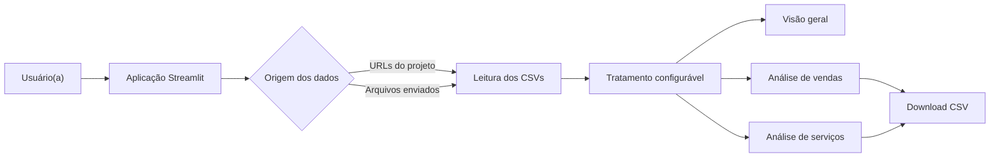

#  Análise de vendas e serviços

> Aplicação em Streamlit para explorar transações de vendas e um catálogo de serviços, inspecionar a qualidade dos dados e exportar bases tratadas.

---

## 📋 Sobre o Projeto

O projeto reúne um notebook de análise exploratória (`PIPELINE.ipynb`) e uma aplicação web feita com Python e Streamlit. A aplicação trabalha com duas bases CSV: transações de vendas e catálogo de serviços.

É possível carregar os arquivos publicados nas URLs do projeto ou enviar versões próprias. Depois do carregamento, a interface apresenta um resumo das bases, opções de limpeza, indicadores, gráficos e downloads em CSV.

---

##  Fluxo da Aplicação



### O que a aplicação apresenta

| Área | Conteúdo |
|---|---|
| **Visão geral** | Quantidade de linhas e colunas, valores ausentes, tipos de dados, duplicatas e amostra das tabelas. |
| **Vendas** | Total e média de `Amount`, valores negativos e dispersão dos valores por funcionário. |
| **Catálogo de serviços** | Relação entre custo e preço, distribuição de preços e quantidade de itens por categoria. |
| **Downloads** | Arquivos CSV com os dados após as opções de tratamento selecionadas. |

---

## Estrutura do Projeto

```text
ProjetoACE_4P/
├── app.py                    # entrada Streamlit e composição das páginas
├── componentes/
│   └── ui.py                 # resumo de dados, cabeçalho e exportação CSV
├── dados/
│   └── loader.py             # URLs, leitura e regras de limpeza
├── paginas/
│   ├── visao_geral.py        # inspeção inicial das bases
│   ├── vendas.py             # indicadores e gráfico de vendas
│   └── servicos.py           # gráficos do catálogo
├── .streamlit/
│   └── config.toml           # tema visual da aplicação
├── PIPELINE.ipynb            # análise exploratória original
├── requirements.txt
└── README.md
```

O app segue uma organização modular: o arquivo principal conecta os módulos, `dados` trata da entrada e limpeza, `paginas` concentra as análises e `componentes` guarda elementos reaproveitados da interface.

---

##  Regras de Tratamento

| Base | Regra |
|---|---|
| **Vendas** | Remove linhas integralmente duplicadas, mantendo a primeira ocorrência. |
| **Vendas** | Com a opção ativada, converte valores negativos de `Amount` para positivos, preservando os registros cuja descrição é `miscellaneous`. |
| **Serviços** | Remove linhas com valores ausentes. |
| **Serviços** | Com a opção ativada, remove itens cujo `Cost` é zero. |

As opções de limpeza ficam na barra lateral. A base original carregada não é alterada: cada página trabalha sobre uma cópia tratada.

---

## 🛠️ Tecnologias


---

## 🚀 Como Executar

### Pré-requisitos

- Python 3.9 ou superior
- Acesso à internet para usar as URLs padrão; arquivos próprios também podem ser enviados

### Passos

```bash
# Clone o repositório
git clone <url-do-repositorio>

# Entre na pasta do projeto
cd ProjetoACE_4P

# Crie e ative um ambiente virtual
python -m venv .venv
source .venv/bin/activate  # Linux/macOS
# No Windows: .venv\Scripts\activate

# Instale as dependências
pip install -r requirements.txt

# Inicie a aplicação
streamlit run app.py
```

O Streamlit abrirá a aplicação no navegador. Escolha **URLs do projeto** para carregar os dados de referência ou **Enviar meus arquivos** para selecionar os dois CSVs. Os controles de limpeza ficam na barra lateral.

### Colunas usadas nos gráficos

- Vendas: `Staff` e `Amount`.
- Serviços: `Cost` e `Price`; as colunas `Cate` e `IsActive` são usadas para segmentar gráficos quando estão disponíveis.

Quando uma coluna necessária não existe, a aplicação informa quais campos são esperados. Para executar o notebook, abra `PIPELINE.ipynb` em um ambiente Jupyter.

---

##  Fontes dos Dados

- [Transações de vendas](https://raw.githubusercontent.com/alvarolucio2007/Engenharia-de-Software/refs/heads/main/4Periodo/CienciaDeDados/ACE/Receipt%20Transactions0.csv)
- [Catálogo de serviços](https://raw.githubusercontent.com/alvarolucio2007/Engenharia-de-Software/refs/heads/main/4Periodo/CienciaDeDados/ACE/Service%20Listing0.csv)

---

##  Escopo

A aplicação foi preparada para exploração e visualização local dos dados. As regras de limpeza refletem as hipóteses registradas no notebook; confirme o significado dos valores negativos com a origem dos dados antes de usar os resultados em relatórios oficiais.
